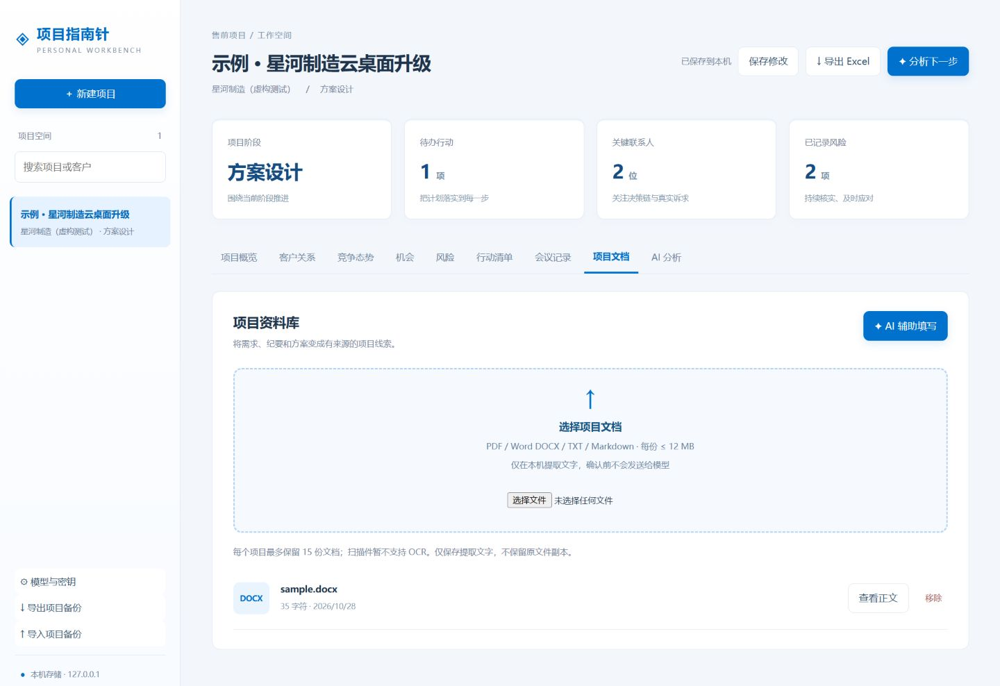

# Project Compass

### Turn project context into your next best action.

A local-first AI workspace for presales and solution professionals.

[English](README.md) · [简体中文](README.zh-CN.md)

[Download for Windows](https://github.com/ks9527/project-compass/releases/latest) · [Release notes](RELEASE_NOTES.md) · [Example dashboard source](examples/project-dashboard.html)

## From scattered context to a clear path forward

Project Compass brings customer insights, competitive context, meeting notes and project documents into one desktop workspace. Connect your own AI provider to assess the situation, identify actionable next steps and share a self-contained HTML dashboard.

## What you can do

| Capability | Purpose |
| --- | --- |
| Project overview | Track background, stage, stakeholders, competitors, risks and opportunities |
| AI guidance | Review project assessments, seven-day action plans and open questions |
| Document-assisted entry | Extract PDF, DOCX, TXT and Markdown locally; review AI drafts before applying |
| Actions and meetings | Keep owners, due dates, status and meeting notes in project context |
| Portable dashboards | Export a single offline HTML file with visuals and formatted AI recommendations |
| Your model, your key | Connect DeepSeek, Qwen, Doubao or an OpenAI-compatible HTTPS endpoint |

## A workflow you control

Create a project → capture customer and competitive context → add documents → review and confirm the AI payload → assess recommendations → choose actions → export a dashboard.

**Local-first storage. Explicit approval before AI requests.** AI analysis requires an internet connection; project management and exported dashboards work offline. The application interface currently uses Simplified Chinese; documentation is available in English and Chinese. All screenshots and examples use fictional data.

## Get started

1. Download the Windows x64 installer from [Releases](https://github.com/ks9527/project-compass/releases/latest). Windows 10 or 11 is required; Node.js is bundled.
2. Install the application. Installation and upgrades create a desktop shortcut by default.
3. On first launch, select a provider, enter your HTTPS endpoint, model or deployment ID, and your own API key. Save and test the connection. The connection test sends a short message without project data.
4. Create a project, add context and documents, then review the exact preview before confirming an AI request. Review extracted fields before applying them.
5. Export an HTML dashboard to open offline or send to others. Re-export after project updates.

The installer is currently unsigned. Windows may display an unverified publisher prompt. Model usage may incur charges from your provider. Before upgrading from v1.2.1 or earlier, export a JSON project backup in the existing app. If the new version opens an empty workspace, import the backup and configure your provider again. Old data is not deleted or moved.

## Share the project story

Export one self-contained HTML dashboard containing project stage, action completion, stakeholders, competition, risks, opportunities, meetings and saved AI recommendations. Recipients can open the downloaded file in a browser without installing Project Compass or configuring an API key. Some email clients block HTML attachments or disable previews; save the file locally and open it in a browser.

Exports contain project information in plain text. They exclude API keys and full document bodies. Check the contents before sharing. Exporting does not call a model or refresh prior analyses.

## Privacy and data boundaries

- Project records and extracted document text are stored in a local SQLite database. They are **not encrypted at rest**. JSON backups and HTML exports are also plain text. Use appropriate disk encryption and directory permissions.
- API keys are encrypted with Windows DPAPI for the current Windows account. They are not returned to the frontend or included in project exports. Configure a new key after moving to another computer or Windows account.
- Only a confirmed analysis or extraction request sends the reviewed preview, system instructions and model parameters to the configured provider. Review and redact sensitive content yourself. Automatic redaction is not provided.
- The server listens on 127.0.0.1 and validates request origin boundaries. This is a single-user application without team synchronization or an account permission system. Do not expose it to the public internet.
- Project data is stored locally for the current user. Use the in-app JSON export for backups while the application is running.

## Document support and current limits

PDF, DOCX, UTF-8 TXT/Markdown and BOM-marked UTF-16LE text are supported. Limits: 12 MB per document, 15 documents per project, 150 pages per PDF, and 60,000 retained characters per document. Original files are not copied into the library; extracted text is stored locally. Scanned PDF OCR, PPT, legacy DOC, internal system integration, automatic task execution and reminders are not currently supported. AI recommendations require human judgment.

## Develop locally

Requires Windows PowerShell and Node.js 22.13+. Clone the repository and run the following commands from its root directory.

~~~powershell
npm ci
npm start        # Web development: http://127.0.0.1:4317
npm run desktop # Electron development
npm test        # Local API and privacy-boundary tests
npm run dist    # Windows x64 installer in release/
~~~

Tests use isolated temporary data and simulated model responses. Real provider connectivity requires your own credentials and available quota. Endpoints must support HTTPS and the OpenAI Chat Completions format; the server appends /chat/completions. The desktop application selects an available local port.

### Architecture

Electron provides the desktop shell and Windows key protection. A local Node.js server manages SQLite data, document extraction and model requests; the browser UI organizes projects and renders AI output. Document parsing runs in a child process. Exported dashboards bundle their own styles and interaction code.

## Feedback and contributions

Open an [issue](https://github.com/ks9527/project-compass/issues) with redacted reproduction steps or a feature suggestion. Never include customer documents, databases or API keys. Run relevant tests before submitting changes.
