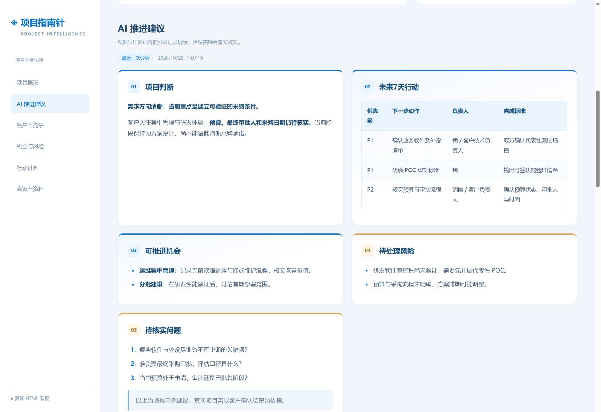

# Project Compass

### 让项目信息，成为下一步行动的依据。

面向售前与解决方案工程师的本地优先 AI 项目工作台。

[English](README.md) · [简体中文](README.zh-CN.md)

[下载 Windows 安装包](https://github.com/ks9527/project-compass/releases/latest) · [版本说明](RELEASE_NOTES.md) · [离线看板示例源码](examples/project-dashboard.html)

## 从项目全貌，到推进路径

把分散的客户线索、竞争信息、会议纪要和项目文档汇集到一个工作空间。Project Compass 帮你梳理项目状态，通过自己的模型接口生成下一步建议，并将项目进展与 AI 分析打包为可离线分享的 HTML 看板。

| 能力 | 带来的价值 |
| --- | --- |
| 项目全景 | 统一管理背景、阶段、客户关系、竞对、风险与机会 |
| AI 推进建议 | 整理项目判断、未来 7 天行动和待核实问题 |
| 文档辅助录入 | 本地解析 PDF / DOCX / TXT / Markdown，核对后填入项目 |
| 行动与会议 | 将负责人、截止日期、状态和沟通记录放回项目上下文 |
| 离线可视化看板 | 导出单文件 HTML，浏览器直接打开，包含已排版 AI 建议 |
| 自选模型 | 接入 DeepSeek、通义、豆包及兼容 OpenAI 的 HTTPS 接口 |

### 一条可控的工作流程

建立项目 → 整理客户与竞争信息 → 导入文档 → 预览并确认发送内容 → 获取 AI 分析 → 人工确认行动 → 导出看板

**资料优先保存在本机；发送内容由你确认。** API Key 使用 Windows 当前账户加密。模型分析需要联网，项目管理与已导出看板可离线使用。软件界面当前为简体中文，本文档支持中英切换。截图及示例中的客户、联系人和项目均为虚构。

## 安装与首次使用

从 [Releases](https://github.com/ks9527/project-compass/releases/latest) 下载 Windows 安装包。支持 Windows 10/11 64 位，内置运行环境，不需要用户安装 Node.js。运行安装程序，可自行选择安装位置。首次启动时配置自己的模型服务和 API Key。

首次打开软件：选择服务商 → 填写 HTTPS 接口、模型名称及 API Key → 点击「保存并测试连接」→ 进入项目空间。测试仅发送一条不含项目资料的短消息。真实连接需要可用的模型额度与网络。程序和安装包尚未进行发行者代码签名，Windows 可能显示发布者未验证提示。

项目资料保存在当前用户的本机环境中，每台电脑独立保存，不提供团队同步。安装包不包含开发者的数据库或密钥。运行中可通过软件导出 JSON 备份。

如需从网页版迁移，请先导出 JSON 备份，再在桌面版导入；API Key 需要重新配置。

安装完成默认在当前用户桌面创建「项目指南针」快捷方式，升级安装也会重新创建。从 v1.2.1 及更早版本升级前，请先在原软件中导出 JSON 备份。新版如显示空工作区，请导入备份并重新配置模型；旧数据不会被删除或移动。

## 功能

- 新建、编辑、删除和搜索项目，记录背景与阶段。
- 客户关系、竞争态势、机会、风险、行动（负责人、日期、状态）、会议记录。
- DeepSeek、通义、豆包和自定义 OpenAI Chat Completions 兼容 HTTPS 接口。豆包模型需填写已开通的模型或接入点 ID。
- 每次分析前展示可编辑资料，勾选确认后才发送；输出包括项目判断、7天行动、机会风险与待核实问题。历史分析存入当前项目；建议需人工判断，可手动录入行动清单。
- 导出和导入 JSON 备份，导入新建副本，不覆盖现有项目。导出不包含密钥与模型配置。
- 项目文档：支持 PDF、DOCX、UTF-8 TXT / Markdown（也支持带 BOM 的 UTF-16LE 文本）。每份 ≤ 12 MB，每项目 ≤ 15 份，PDF 最多 150 页。仅本机提取并保存正文，原始文件不复制进资料库。长文档只保留前 60,000 字符并提示；扫描件暂不支持 OCR。
- AI 辅助填写：选文档 → 检查并脱敏发送正文 → 勾选发送确认 → 核对提取草稿及原文依据 → 勾选填入。客户与阶段替换所选字段；背景可追加或替换；客户关系、竞对、风险机会与行动追加记录。不会未经确认覆盖项目。
- 单项目 HTML 看板：导出一个自带样式的 `.html` 文件，双击即可离线打开。包含阶段、行动完成率、客户与竞对、风险机会、行动计划、会议、文档来源与已有 AI 建议。导航和会议折叠无需联网，不含密钥或文档完整正文；导出不会自动调用模型，项目更新后需重新导出。

AI 分析在 APP 和导出看板中使用相同的安全排版：标题卡片、重点文字、列表、表格和代码块。旧分析记录无需重新调用模型即可按新样式显示。模型生成的 HTML 不会作为代码执行，外部图片不会被加载。

## 数据与密钥

数据库名为 `workbench.sqlite`。项目与文档正文是未加密的本地 SQLite 数据，JSON 与 HTML 看板导出也是明文；建议启用磁盘加密并限制目录访问，不要将 data 或备份上传到公开仓库。退出软件后可备份整个 data 目录，运行中优先使用界面导出。

API Key 经 Windows DPAPI 以当前账户加密后存入数据库，网页不会读回密钥；更换 Windows 账户或电脑需重新配置。密钥不会放进源代码、导出文件或浏览器存储。服务只监听 127.0.0.1，并校验 Host、Origin 与写请求头，不应反向代理到公网。它是单用户本机工具，没有登录和团队权限体系。

点击确认分析或确认提取后，才会将可见的预览资料、固定系统提示和模型参数发送给配置的服务。系统提示要求模型基于事实区分推测，输出判断、行动、风险机会、待核实问题；分析预览包含文档正文，历史分析不会自动发送。请手动脱敏并确认公司允许使用该模型服务；接口调用可能产生服务商费用。

页面编辑需点「保存修改」。切换项目、开始分析和导出前也会保存，关闭未保存页面会提示。暂不支持 PPT、旧版 DOC、图片 OCR、公司内部系统接入、自动脱敏、自动执行建议或自动提醒。示例全部为虚构资料。

## 源码开发与打包

克隆仓库后，在项目根目录运行开发命令。开发需要 Node.js 22.13+、Windows PowerShell 和项目依赖：`npm ci`；`npm start` 启动网页版，`npm run desktop` 启动桌面开发版，`npm run dist` 生成 EXE 安装包。网页地址为 http://127.0.0.1:4317；桌面版自动选择空闲的本机端口。

`release/win-unpacked` 是验证用目录，发给其他人应使用 Setup EXE。如正式公开发行，建议为程序和安装包配置代码签名证书。

## 验证

`npm test` 运行本地接口和安全边界测试，使用独立临时数据库与虚构模型响应，不消耗真实 API。真实模型连通性需要用户自行配置密钥后验证。配置支持 HTTPS 基础地址，服务自动追加 `/chat/completions`。

## 反馈与贡献

欢迎通过 [Issues](https://github.com/ks9527/project-compass/issues) 提交问题和功能建议。请使用脱敏后的复现步骤，不要上传真实客户资料、数据库或 API Key。提交改动前请运行相关测试。
